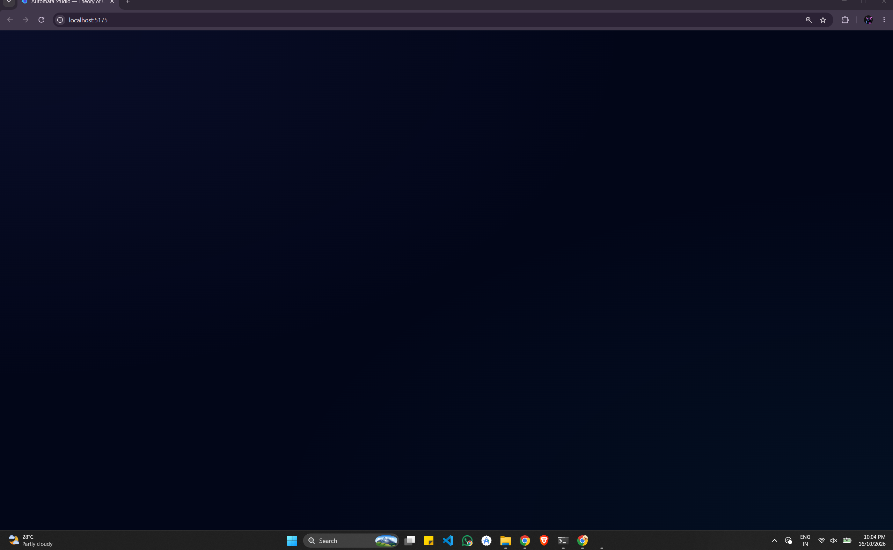
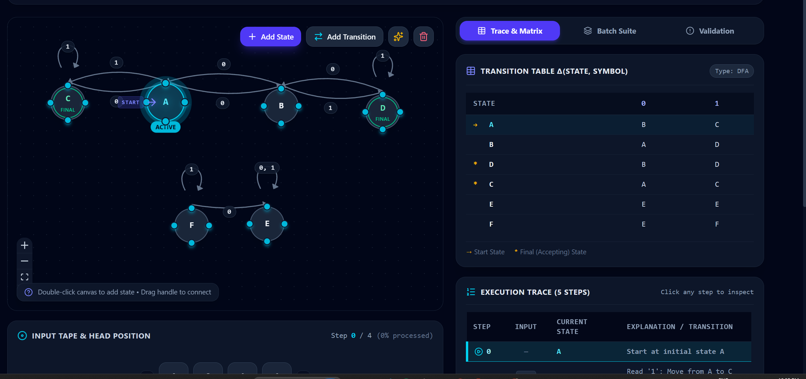
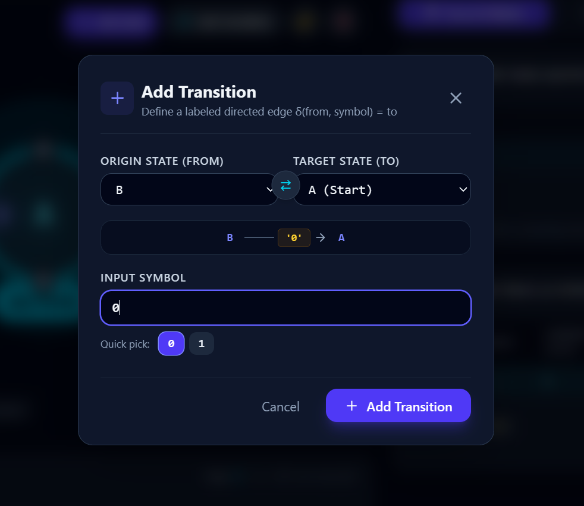
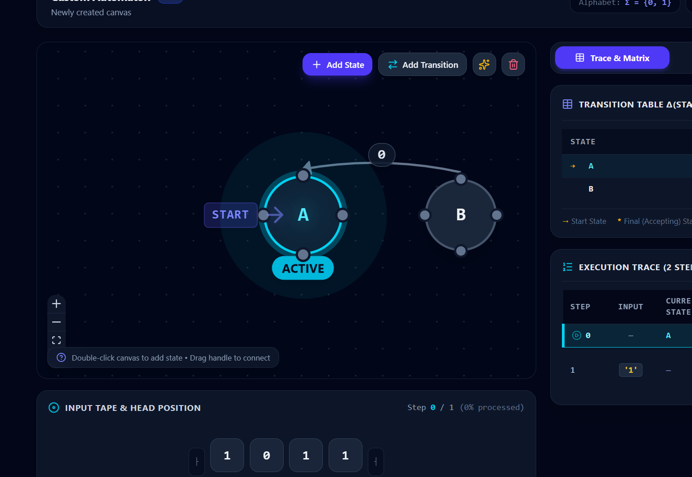

# 🌀 Automata Studio — Theory of Computation Visualizer & Simulator

[](https://react.dev/)
[](https://www.typescriptlang.org/)
[](https://vite.dev/)
[](https://tailwindcss.com/)
[](https://reactflow.dev/)
[](https://opensource.org/licenses/MIT)

> An interactive, high-performance web platform for visualizing, simulating, converting, and minimizing Finite State Automata (**DFA**, **NFA**, and **ε-NFA**) built for students, educators, and computer science enthusiasts studying **Theory of Computation (TOC)** and **Formal Languages**.

---



## ✨ Key Features

### 1. 🎨 Interactive Automata Canvas
- **Visual Graph Editor**: Built with `@xyflow/react` for smooth, high-fps drag-and-drop state manipulation, zooming, panning, and auto-layout.
- **Node Configuration**: Set states as **Initial (Start)**, **Accepting (Final)**, or normal with real-time double-ring rendering.
- **Dynamic Transitions**: Create curved edges, self-loops, multi-symbol transitions, and customizable state naming formats (`q0, q1, q2...` or `A, B, C...`).

### 2. ⚡ Multi-Model Simulation Engine
- **DFA (Deterministic Finite Automata)**: Instant step-by-step state verification with deterministic transition tables.
- **NFA (Non-Deterministic Finite Automata)**: Parallel state tracking simulating all active branches simultaneously.
- **ε-NFA (Epsilon-NFA)**: Full **Epsilon Closure ($\varepsilon$-closure)** calculation supporting $\varepsilon$, $\lambda$, or `e` transition symbols.

### 3. 📼 Tape Execution & Trace Matrix
- **Physical Input Tape**: Animated tape showing the tape head reading symbols one by one.
- **Playback Controls**: Step Next ($\to$), Step Previous ($\leftarrow$), Play/Pause ($\text{Space}$), adjustable simulation speed, and Reset ($R$).
- **Live Explanation**: Real-time natural language explanation for every transition taken and epsilon closure traversed.
- **Interactive Trace Table**: Chronological matrix recording each step, symbols consumed, active state sets, and outcomes.

### 4. 🪄 Subset Construction (NFA $\to$ DFA Conversion)
- Automatically transforms any NFA or $\varepsilon$-NFA into an equivalent DFA using power set subset construction.
- Generates a full transition table of composite state subsets (e.g., $\{q_0, q_1\}$) and allows 1-click loading of the converted DFA directly onto the canvas.

### 5. 📉 DFA Minimization
- Minimizes any DFA using standard equivalence partitioning / Hopcroft's algorithm.
- Identifies unreachable states, separates final and non-final states, and merges indistinguishable states into a minimal canonical automaton.

### 6. 🧪 Batch Test Suite
- Run comprehensive test suites with multiple test strings simultaneously.
- Mark expected outcomes (`Accept` / `Reject`) to auto-evaluate correctness with pass/fail badges and detailed execution breakdowns.

### 7. ⚠️ Formal Language Validation
- Detects non-determinism in DFAs (duplicate transitions for identical symbols).
- Identifies missing transitions, undefined symbols outside $\Sigma$, disconnected/orphan states, and missing start states.

### 8. 📚 Built-in Preset Library
Includes textbook-standard examples:
- **Binary Strings ending with `01`**
- **Even number of `0`s and even number of `1`s**
- **Divisible by 3 in Binary**
- **Contains Substring `101`**
- **$\varepsilon$-NFA union and concatenation models**

### 9. 💾 Import / Export
- Export and import automata definitions in JSON format for easy sharing, assignments, and archiving.

---

## 📸 Screenshots

| Interactive Workspace | Modals & Conversion |
|:---:|:---:|
|  |  |
|  |  |

---

## 🚀 Getting Started

### Prerequisites
- [Node.js](https://nodejs.org/) (v18 or higher recommended)
- [npm](https://www.npmjs.com/) or [pnpm](https://pnpm.io/) or [yarn](https://yarnpkg.com/)

### Installation

1. **Clone the repository:**
   ```bash
   git clone https://github.com/PRTAWARE/toc-automata-visualizer.git
   cd toc-automata-visualizer
   ```

2. **Install dependencies:**
   ```bash
   npm install
   ```

3. **Start the development server:**
   ```bash
   npm run dev
   ```

4. **Open your browser:**
   Navigate to `http://localhost:5173` to explore Automata Studio.

### Production Build
To create an optimized production bundle:
```bash
npm run build
npm run preview
```

---

## ⌨️ Keyboard Shortcuts

| Shortcut | Action |
|:---|:---|
| <kbd>Space</kbd> | Play / Pause Simulation |
| <kbd>→</kbd> | Step Forward |
| <kbd>←</kbd> | Step Backward |
| <kbd>R</kbd> | Reset Simulation |

---

## 🛠️ Tech Stack

- **Framework**: React 19 + TypeScript
- **Bundler**: Vite 8
- **Styling**: TailwindCSS 4
- **Graph & Canvas Visualization**: `@xyflow/react` (React Flow)
- **Icons**: `lucide-react`
- **Effects**: `canvas-confetti`
- **Linter**: `oxlint`

---

## 📂 Project Structure

```text
toc-automata-visualizer/
├── public/                 # Static assets
├── screenshots/            # UI screenshots for documentation
├── src/
│   ├── components/
│   │   ├── Canvas/         # AutomataCanvas and custom state/transition nodes
│   │   ├── Navbar/         # Header, alphabet configurator, modals
│   │   ├── Panels/         # TraceTable, BatchTester, Minimizer, Presets
│   │   ├── Simulation/     # Playback controls, InputTape, ResultBanner
│   │   └── Tape/           # Interactive input tape visualization
│   ├── context/            # AutomataContext & state management
│   ├── simulation/         # DFA, NFA, ε-NFA, Minimization & Converter algorithms
│   ├── types/              # Formal automata TypeScript interfaces
│   ├── App.tsx             # Main dashboard layout
│   └── main.tsx            # Application entry point
├── package.json
├── tsconfig.json
└── vite.config.ts
```

---

## 🤝 Contributing

Contributions, issues, and feature requests are welcome! Feel free to check the [issues page](https://github.com/PRTAWARE/toc-automata-visualizer/issues).

1. Fork the Project
2. Create your Feature Branch (`git checkout -b feature/AmazingFeature`)
3. Commit your Changes (`git commit -m 'Add some AmazingFeature'`)
4. Push to the Branch (`git push origin feature/AmazingFeature`)
5. Open a Pull Request

---

## 📄 License

This project is licensed under the MIT License — feel free to use it for academic and educational purposes.
